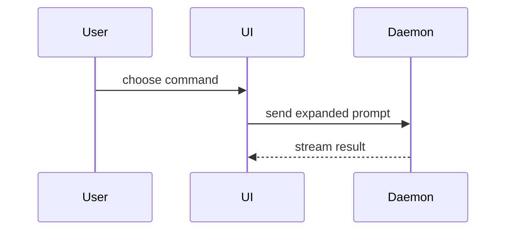

Read `~/.agents/skills/POLICY.md` before applying this skill. It governs personal workflow; mandatory repository rules remain binding.

Apply when the user explicitly requests a PR draft or authorized publication. Writing a PR body means drafting it, not publishing it. Publish or update a PR only when the current task explicitly authorizes that action; never automatically commit, push or update tracker state.

Read the task/issue intent, actual diff, existing PR context and required repository PR template. Keep all required sections and fields; adapt the structure below into them rather than replacing the template. Use only evidence already exercised or explicitly authorized to obtain, and clearly label limitations and pending checks.

When no repository template dictates structure, use this compact shape, omitting optional visuals and risk sections that add no value:

```markdown
## Summary

<Why this change is needed and what outcome it enables, in one or two sentences.>

<optional diagram, diff-sketch, or tree>

## Evidence

- **Exercised:** <actual command, output or runtime evidence>
- **Pending / limitations:** <unrun checks or known limits, when applicable>

## Merge Danger

**Door:** <one-way or two-way>

<optional: description>

**Blast Radius:** <concrete affected consumers/data/surface>

<optional: potential ramifications of merge>
```

## Sections

Skip preambles and keep prose brief. Use authoritative domain/API vocabulary (an existing glossary when applicable), not forced skill terminology.

### Summary

Pick the smallest view that makes the key point clear.

- Show logic or an algorithm as pseudocode:

```text
on(save)
  if content is unchanged
    return cached result
  write new content
  return fresh result
```

- Show runtime control flow as a call tree:

```text
submitForm
  createSession
    persistPrompt
    launchAgent
  navigateToSession
```

- Show UI structure as a component tree, including state and module boundaries that matter:

```text
<SessionPage> (apps/example/src/routes/session.tsx)
  useSessionEvents()
  <SessionToolbar>
    <RunSkillButton> (packages/ui)
```

- Show file responsibility or a broad refactor as a shallow file tree:

```text
src/
├── commands/       # parses user actions
├── sessions/       # owns session state
└── transport/      # sends API requests
```

- Show component interaction, control flow, or data flow with Mermaid:



- Use `diff` when the point is what changes and the surrounding shape already exists. Match the diff shape to the topic.

For a component change:

```diff
 <SessionPage>
   useSessionEvents()
   <SessionToolbar>
+    <RunSkillButton />
   <SessionTimeline>
+    <SkillResultCard />
```

For a file-layout change:

```diff
 src/
 ├── commands/
+│   └── show-me.ts       # expands the slash command
 ├── sessions/
-└── transport.ts
+└── transport/
+    ├── client.ts
+    └── stream.ts
```

For a call-tree or call-stack change:

```diff
 submitForm
   createSession
     persistPrompt
+    expandSkillMention
     launchAgent
-  navigateToSession
+  navigateToSession
+    subscribeToEvents
```

For a state or control-flow change:

```diff
 on(save)
-  write content
+  if content is unchanged
+    return cached result
+  write new content
+  invalidate cache
```

- Show the whole block when most of it is new, when omitted context would hide ownership or order, or when the user needs a copyable target shape:

```ts
function expandSkill(command: string): string {
  const skillName = command.slice(1);
  return `use the ${skillName} skill`;
}
```

#### Guidance

Place each visual next to the short text it supports. Keep only the calls, files, props, states, and boundaries needed to answer the user's current question or the options to resolve the current discussion point.

You may use one of these, you may use several, it is unlikely you will use all of them. Use your judgement and don't overwhelm the user.

### Evidence

Concrete **observed** evidence that the change works. Include before/after only when both were actually captured; don't fabricate a failed-before run, passing-after run, screenshot or output.

For visual changes, real screenshots or runtime observations are useful when available. For behavior, cite exact exercised commands/tests and actual results; don't substitute pseudocode for execution evidence.

Separate exercised evidence from pending checks and known limitations. If checks weren't run, say so and name relevant pending verification without implying success. Don't launch broad verification merely to fill this section.

### Merge Danger

Describe whether it's a one-way or two-way door. You can walk back through two-way doors, but not one-way doors. A PR that is cheap to roll back is lower risk. Changes that involve destructive actions or hard-to-reverse decisions are one-way doors.

The blast radius is the plausible affected consumers, data and deployment surface. Describe concrete impact and rollback/migration constraints when useful; don't invent risk categories or require a one-word label. Distinguish observed limitations from inferred risks.
